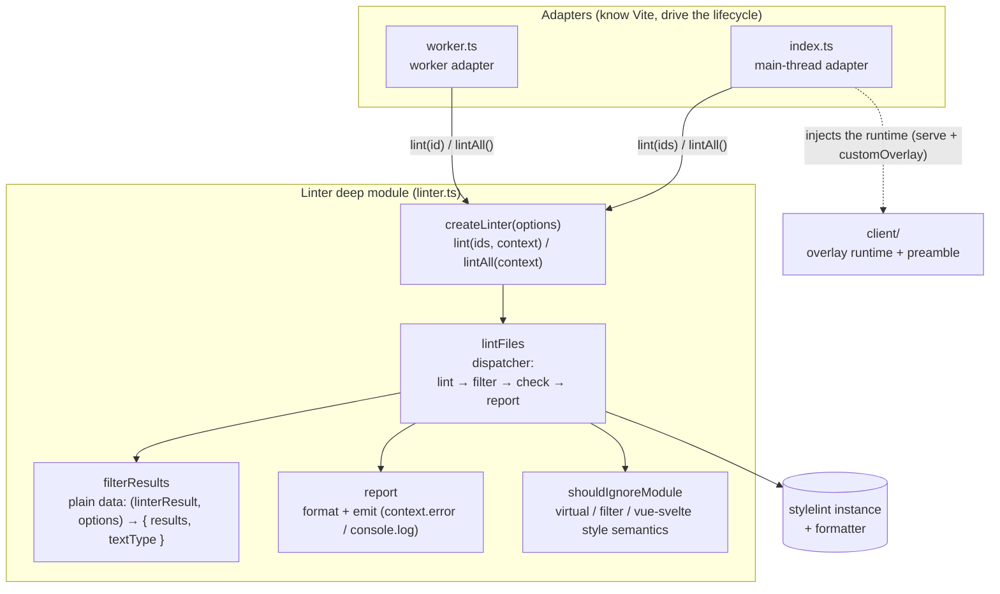

# Contributing to vite-plugin-stylelint

Thanks for your interest in contributing! This guide covers the architecture and how to set up a local development environment.

## Prerequisites

- Node.js `^22.22.2` or `>=24.15.0`. The toolchain (pnpm 12, ultracite, Stylelint 18) does not run on older releases.
- pnpm 12 (enforced via `only-allow`). `packageManager` in `package.json` pins the exact version.
- Stylelint v18 if you want to run the example.

## Local development

```sh
# 1. Clone and install
git clone https://github.com/ModyQyW/vite-plugin-stylelint.git
cd vite-plugin-stylelint
pnpm install

# 2. Start the core package in watch mode (rebuilds dist/ on every change)
pnpm dev

# 3. In another terminal, run the example against the local build
pnpm -C examples/react-ts dev
# or: pnpm -C examples/react-ts build
```

The example links to the core package via `workspace:*`, so it consumes whatever is in `packages/core/dist/`. Keep `pnpm dev` running while you iterate.

### Useful scripts

| Command          | Purpose                                                        |
| ---------------- | -------------------------------------------------------------- |
| `pnpm dev`       | Watch-build all packages                                       |
| `pnpm build`     | One-shot build (tsdown → `dist/`)                              |
| `pnpm typecheck` | `tsc --noEmit` for the repo and for the docs site              |
| `pnpm test`      | Run vitest once                                                |
| `pnpm fix`       | Auto-fix formatting and safe lint findings (Biome via ultracite) |
| `pnpm check`     | Report lint and formatting problems without fixing             |
| `pnpm docs:dev`  | Run the Rspress docs site locally                              |

### Verifying a change

Before opening a PR, run the same commands CI runs:

```sh
pnpm fix && pnpm check && pnpm typecheck && pnpm test && pnpm build && pnpm -r --filter=./examples/* run build
```

The last command builds the example with the local plugin build, so it catches runtime problems the unit tests cannot see.

`pnpm test` includes `linter.integration.test.ts`, which lints a temporary project with the installed Stylelint. A breaking change in Stylelint's Node API fails there instead of in a user's build.

## Architecture

The plugin runs Stylelint over the modules Vite processes. The coordination lives in one deep module (`Linter`); two thin adapters drive it depending on the `lintInWorker` option.



### Module responsibilities

| Module      | Role                                                                                                                                                                                         | Knows about                              |
| ----------- | -------------------------------------------------------------------------------------------------------------------------------------------------------------------------------------------- | ---------------------------------------- |
| `index.ts`  | Main-thread adapter. Holds `worker` / `linter` and wires the Vite hooks (`apply`, `configResolved`, `configureServer`, `buildStart`, `resolveId`, `load`, `transformIndexHtml`, `transform`, `buildEnd`). Batches the transform id with its watch files and runs the overlay handshake. | Vite plugin lifecycle, worker lifecycle, overlay handshake |
| `worker.ts` | Worker adapter. Forwards `parentPort` messages to `linter.lint(id)`. Under 40 lines.                                                                                                          | Node `worker_threads` only               |
| `linter.ts` | The deep module. Owns `createLinter`, `filterResults` (pure, exported for testing), `OverlayManager`, `report`, `shouldIgnoreModule` (exported for testing) and every private collaborator.    | Stylelint only, no Vite or worker concepts |
| `utils.ts`  | `getOptions`, which normalizes user options into defaults.                                                                                                                                    | The option shape only                    |
| `client/`   | Browser side of the custom overlay. `preamble.ts` builds the inline bootstrap script; `runtime.ts` is a standalone ESM bundle (Shadow DOM, no imports) that renders the panel and answers the WebSocket handshake. | The DOM, the plugin's WebSocket events |

### Key design rules

- **The `Linter` is the only place that schedules a lint pass.** Adapters translate their outside world (Vite hooks, worker messages) into `lint(ids)` / `lintAll()` calls. They never assemble `stylelint.lint(...)` plus a formatter themselves.
- **`context` is a per-call parameter, not a captured closure.** Vite runs transform hooks concurrently, so a shared context would be overwritten between concurrent lints and emit would reach the wrong module's `PluginContext`. The main-thread adapter passes `this` at call time; the worker omits it and emits to stdout only.
- **`filterResults` works on plain data.** `(linterResult, options) → { results, textType }`, no I/O and no Stylelint instance, which is why it carries the tests for the emit-filter and textType logic. It does mutate its input: turning `emitError` off clears `linterResult.errored` so the severity channel matches the filtered result. `report` (format + emit) stays private; `createLinter` and the example cover it.
- **Worker color matches the main thread.** A worker's stdout is a pipe, not a TTY, so picocolors disables color at module load. `index.ts` passes the main thread's color support through `getWorkerEnv`, honors explicit user overrides (`NO_COLOR` / `FORCE_COLOR`), and forces color on only when the parent is a TTY.
- **`.vue` / `.svelte` style semantics are the opposite of the ESLint plugin.** Stylelint lints `<style>` blocks, so `xxx.vue?type=style` / `yyy.svelte?type=style` modules are kept while plain `.vue` / `.svelte` modules are ignored. See `shouldIgnoreModule`.
- **Plugin options and Stylelint options share one namespace.** `StylelintPluginOptions extends StylelintLinterOptions`. `PLUGIN_OPTION_KEYS` (`constants.ts`) separates them by exclusion inside `getStylelintLinterOptions`. **Append every new plugin option to `PLUGIN_OPTION_KEYS`**, otherwise it is silently forwarded to `stylelint.lint()`. `cache`, `cacheLocation` and `fix` are absent on purpose: they are real Stylelint options the plugin forwards.

### Custom overlay

Under `serve` with `customOverlay` enabled, `index.ts` injects the runtime through `transformIndexHtml`, waits for the browser to ping `vite:stylelint:runtime-loaded`, and only then pushes payloads over `vite:stylelint:overlay`. Payloads that arrive before the ping are buffered. If no ping arrives within `OVERLAY_DEGRADE_GRACE_MS` (2s), the plugin assumes a DOM-less environment (mini-program, SSR, headless), warns once and stops pushing. In worker mode the worker forwards payloads to the main thread over `parentPort`, and `index.ts` runs the same handshake.

### Adding a new plugin option

1. Add the field to `StylelintPluginOptions` / `StylelintPluginUserOptions` in `types.ts`, with a bilingual JSDoc comment matching the existing style.
2. Set its default in `getOptions` (`utils.ts`).
3. **Append the field name to `PLUGIN_OPTION_KEYS`** (`constants.ts`). This step is easy to miss and fails silently: without it the option reaches `stylelint.lint()`.
4. If the option affects filtering or the textType decision, extend `filterResults` and add a test in `linter.test.ts`.

## Documentation site

The docs site is Rspress. The workspace package is `docs/`:

```tree
docs/
├── rspress.config.ts   # site config: locales, nav, head tags
├── seo.ts              # canonical, Open Graph and JSON-LD head tags
├── docs/               # content root, one directory per locale
│   ├── en/
│   ├── zh/
│   └── public/         # robots.txt, _headers and the Open Graph image
└── tsconfig.json
```

Rspress generates `llms.txt`, `llms-full.txt` and a Markdown file per page during `pnpm docs:build`, which is why the site is readable by agents without a HTML-to-text step. Nav and sidebar come from `_nav.json` and `_meta.json` inside each locale directory. Keep the English and Chinese pages in step: same headings, same commands.

## Committing

- CI runs `pnpm check`, `pnpm build`, the example builds, `pnpm test` and `pnpm typecheck` on Node.js 22, 24 and 26 across Linux, macOS and Windows. There is no git hook, so run the same commands locally before pushing.
- `pnpm release` (lerna) runs `pnpm fix`, `pnpm typecheck` and `pnpm test` through `preversion`.
- Commit messages follow [Conventional Commits](https://www.conventionalcommits.org/) (`feat:`, `fix:`, `refactor:`, `docs:`, `chore:`).
