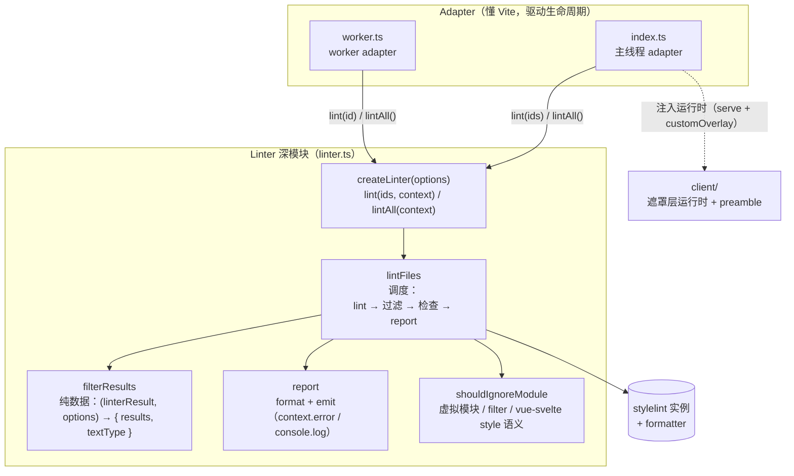

# 贡献 vite-plugin-stylelint

感谢你有兴趣贡献！这份指南介绍项目架构和本地开发环境怎么搭。

## 前置条件

- Node.js `^22.22.2` 或 `>=24.15.0`。工具链（pnpm 12、ultracite、Stylelint 18）在更老的版本上跑不起来。
- pnpm 12（通过 `only-allow` 强制）。具体版本由 `package.json` 的 `packageManager` 固定。
- 想跑示例的话，需要 Stylelint v18。

## 本地开发

```sh
# 1. 克隆并安装
git clone https://github.com/ModyQyW/vite-plugin-stylelint.git
cd vite-plugin-stylelint
pnpm install

# 2. 以 watch 模式启动核心包（每次改动重新构建 dist/）
pnpm dev

# 3. 在另一个终端，用本地构建产物跑示例
pnpm -C examples/react-ts dev
# 或：pnpm -C examples/react-ts build
```

示例通过 `workspace:*` 链接到核心包，读到的是 `packages/core/dist/` 里的当前产物。迭代时让 `pnpm dev` 一直开着。

### 常用脚本

| 命令             | 用途                                             |
| ---------------- | ------------------------------------------------ |
| `pnpm dev`       | watch 构建所有包                                 |
| `pnpm build`     | 一次性构建（tsdown → `dist/`）                    |
| `pnpm typecheck` | 对仓库和文档站点分别跑 `tsc --noEmit`            |
| `pnpm test`      | 跑一次 vitest                                     |
| `pnpm fix`       | 自动修格式和安全的 lint 问题（Biome，经 ultracite） |
| `pnpm check`     | 只报告格式和 lint 问题，不改文件                  |
| `pnpm docs:dev`  | 本地运行 Rspress 文档站点                         |

### 验证改动

提 PR 之前，把 CI 会跑的命令在本地跑一遍：

```sh
pnpm fix && pnpm check && pnpm typecheck && pnpm test && pnpm build && pnpm -r --filter=./examples/* run build
```

最后一条会用本地构建的插件跑一遍示例，能抓到单元测试看不到的运行时问题。

`pnpm test` 包含 `linter.integration.test.ts`，它用装好的 Stylelint 校验一个临时项目。Stylelint 的 Node API 一旦有破坏性改动，测试会先失败，而不是等到用户构建时才炸。

## 架构

插件对 Vite 处理过的模块运行 Stylelint。调度逻辑集中在一个深模块（`Linter`）里，由两个轻量 adapter 按 `lintInWorker` 选项分别驱动。



### 模块职责

| 模块        | 角色                                                                                                                                                    | 知晓的概念                 |
| ----------- | ------------------------------------------------------------------------------------------------------------------------------------------------------- | -------------------------- |
| `index.ts`  | 主线程 adapter。持有 `worker` / `linter`，接 Vite 钩子（`apply`、`configResolved`、`configureServer`、`buildStart`、`resolveId`、`load`、`transformIndexHtml`、`transform`、`buildEnd`），把 transform 的 id 和它的 watch files 合成一批，并负责遮罩层握手。 | Vite 插件生命周期、worker 生命周期、遮罩层握手 |
| `worker.ts` | worker adapter。把 `parentPort` 消息转发给 `linter.lint(id)`。不到 40 行。                                                                                | 只有 Node `worker_threads`   |
| `linter.ts` | 深模块。包含 `createLinter`、`filterResults`（纯函数，导出供测试）、`OverlayManager`、`report`、`shouldIgnoreModule`（导出供测试）以及所有私有协作函数。   | 只有 Stylelint，不涉及 Vite / worker |
| `utils.ts`  | `getOptions`，把用户选项归一化为默认值。                                                                                                                | 只有选项的形状             |
| `client/`   | 自定义遮罩层的浏览器侧。`preamble.ts` 生成内联启动脚本，`runtime.ts` 打包成独立的 ESM（Shadow DOM，无 import），负责渲染面板并完成 WebSocket 握手。 | DOM、插件自己的 WebSocket 事件 |

### 关键设计规则

- **`Linter` 是唯一知道怎么调度一次 lint 的地方。** Adapter 把外部世界（Vite 钩子、worker 消息）翻译成 `lint(ids)` / `lintAll()` 调用，自己绝不拼 `stylelint.lint(...)` 加 formatter。
- **`context` 是 per-call 参数，不是闭包变量。** Vite 的 transform 钩子是并发执行的：共享的 context 会在并发 lint 之间被覆盖，emit 就会跑到别的模块的 `PluginContext` 上。主线程 adapter 在调用时传 `this`；worker 不传，只输出到 stdout。
- **`filterResults` 只处理纯数据。** `(linterResult, options) → { results, textType }`，没有 I/O，也没有 stylelint 实例，emit 过滤和 textType 的判断靠它来测。它会改传入的对象：关掉 `emitError` 时会把 `linterResult.errored` 清成 `false`，让严重级别和过滤后的结果对得上。`report`（format + emit）保持私有，由 `createLinter` 和示例覆盖。
- **worker 的颜色和主线程一致。** worker 的 stdout 是管道不是 TTY，picocolors 在模块加载时就会关掉颜色。`index.ts` 通过 `getWorkerEnv` 把主线程的颜色支持传过去，尊重用户显式设置的 `NO_COLOR` / `FORCE_COLOR`，只有父进程是 TTY 时才强制开颜色。
- **`.vue` / `.svelte` 的 style 语义和 ESLint 插件相反。** Stylelint 校验的是 `<style>` 块，所以 `xxx.vue?type=style` / `yyy.svelte?type=style` 模块保留，不带 `?type=style` 的普通 `.vue` / `.svelte` 模块忽略。见 `shouldIgnoreModule`。
- **插件选项和 Stylelint 选项共用一个命名空间。** `StylelintPluginOptions extends StylelintLinterOptions`。`PLUGIN_OPTION_KEYS`（`constants.ts`）在 `getStylelintLinterOptions` 里用排除法把两者分开。**新增插件选项时必须把字段名加进 `PLUGIN_OPTION_KEYS`**，否则它会被悄悄透传给 `stylelint.lint()`。`cache`、`cacheLocation`、`fix` 故意不在列表里，它们是真实的 Stylelint 选项，插件本来就要透传。

### 自定义遮罩层

`serve` 下开启 `customOverlay` 时，`index.ts` 通过 `transformIndexHtml` 注入运行时，等浏览器 ping 回 `vite:stylelint:runtime-loaded`，之后才把数据推到 `vite:stylelint:overlay`。ping 之前到达的数据先缓存。`OVERLAY_DEGRADE_GRACE_MS`（2 秒）内没收到 ping，就认为环境里没有 DOM（小程序、SSR、无头），警告一次然后不再推送。worker 模式下由 worker 通过 `parentPort` 把数据转给主线程，`index.ts` 走同一套握手。

### 新增一个插件选项

1. 在 `types.ts` 的 `StylelintPluginOptions` / `StylelintPluginUserOptions` 里加字段，配上和现有风格一致的双语 JSDoc 注释。
2. 在 `getOptions`（`utils.ts`）里设默认值。
3. **把字段名加进 `PLUGIN_OPTION_KEYS`（`constants.ts`）。** 这一步最容易漏，而且失败时没有报错：漏了就透传给 `stylelint.lint()` 了。
4. 如果这个选项影响过滤或 textType 的判断，扩展 `filterResults`，并在 `linter.test.ts` 补测试。

## 文档站点

文档站点用 Rspress。工作区包是 `docs/`：

```tree
docs/
├── rspress.config.ts   # 站点配置：语言、导航、head 标签
├── docs/               # 内容根目录，一种语言一个目录
│   ├── en/
│   └── zh/
├── theme/              # 自定义主题（Layout 覆写 + AdSense 单元）
└── tsconfig.json
```

`pnpm docs:build` 时 Rspress 会额外生成 `llms.txt`、`llms-full.txt` 和每页对应的 Markdown 文件，agent 不用先把 HTML 转成文本就能读。导航和侧边栏来自各语言目录里的 `_nav.json` 和 `_meta.json`。中英文页面要保持一致：标题相同，命令相同。

## 提交

- CI 在 Linux、macOS、Windows 上分别用 Node.js 22、24、26 跑 `pnpm check`、`pnpm build`、示例构建、`pnpm test` 和 `pnpm typecheck`。项目没有 git hook，推之前自己跑一遍。
- `pnpm release`（lerna）会通过 `preversion` 跑 `pnpm fix`、`pnpm typecheck` 和 `pnpm test`。
- 提交信息遵循 [Conventional Commits](https://www.conventionalcommits.org/)（`feat:`、`fix:`、`refactor:`、`docs:`、`chore:`）。
